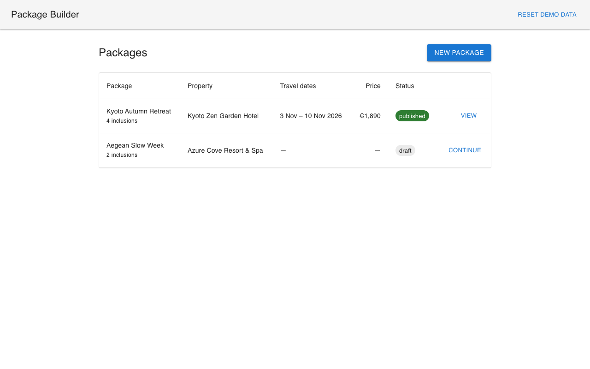
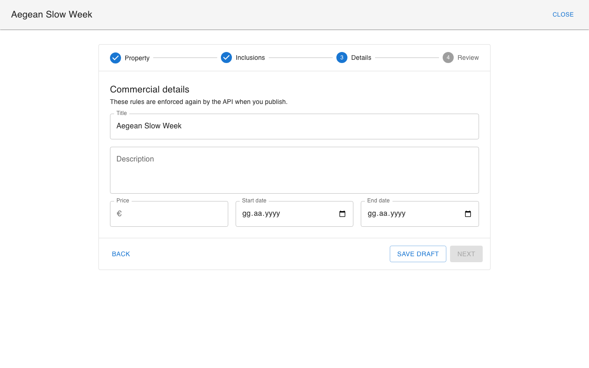

# Package Builder

A small admin tool for assembling a vacation package step by step, drafting and publishing it:
a packages list, a four-step wizard, and a REST API that owns the business rules.

- `backend/` — Laravel 13, SQLite
- `frontend/` — React 19 + TypeScript + MUI, Vite

Tested with PHP 8.4 and Node 22.

| Packages list | Wizard, reopened draft |
| --- | --- |
|  |  |

The wizard screenshot shows a reopened draft: it lands on the first step that still
needs work, the completed steps are checked, and Next stays locked until the step is valid.

## Running it

The frontend proxies `/api` to the backend, so both apps are same-origin in development and there is no CORS configuration to keep in sync.

### Backend

```bash
cd backend
composer install
cp .env.example .env && php artisan key:generate
php artisan migrate:fresh --seed
php artisan serve
```

Runs on http://localhost:8000. The seeder loads `database/data/seed.json` — the six properties and twelve inclusions from the brief, verbatim and with their given ids.

### Frontend

```bash
cd frontend
npm install
npm run dev
```

Runs on http://localhost:5173.

### Tests and typecheck

```bash
cd backend && php artisan test
cd frontend && npx vitest run && npm run typecheck
```

### Resetting

`POST /api/dev/reset` drops the database back to the seed data and answers 404 outside the local and testing environments.

## API

| Method | Route | Purpose |
| --- | --- | --- |
| GET | `/api/properties?search=` | Seed properties; server-side search over name and location |
| GET | `/api/inclusions` | Seed inclusions, category included |
| GET | `/api/packages` | List rows: status, property, dates, price, inclusion count |
| POST | `/api/packages` | Create a draft from any subset of the fields |
| GET | `/api/packages/{id}` | One package, enough to restore the wizard |
| PATCH | `/api/packages/{id}` | Update a draft; 409 once published |
| POST | `/api/packages/{id}/publish` | Run the business rules and publish; 409 if already published |
| POST | `/api/dev/reset` | Reset to seed data (local only) |

Validation failures come back in Laravel's own 422 shape, one key per field or rule:

```json
{
  "message": "...",
  "errors": {
    "title": ["The title field must be at least 5 characters."],
    "inclusions": ["At least one inclusion is required."]
  }
}
```

## Architecture decisions

**Publish is a separate endpoint, not a writable `status` field.** With `PATCH` +
`{"status":"published"}` the update endpoint needs two rule sets behind an `if` —
lax while draft, strict on the flip. Separate endpoints, separate FormRequests, no
branch. `status` is not in `$fillable` either, so mass assignment can't reach it.

**Publish validates the stored package, not the request body.** The call has no
payload. `PublishPackageRequest::validationData()` feeds the rules the model's current
state instead. That is what makes the server the source of truth in practice.

**Editing a published package returns 409.** Not 403: the caller is fine, and the same
request worked yesterday. Not 422: there is nothing in the payload to fix.

**Drafts get type checks only.** Every column but `status` is nullable and every draft
rule is `sometimes|nullable`. Completeness is a publish rule, not a schema constraint.

**One reducer, gating as pure functions.** `isStepValid` and `canGoTo` drive four things:
stepper checkmarks, stepper clickability, Next, Publish. Rule lives once. Also means the
gating tests need no rendering.

**The client repeats the server rules on purpose.** zod tells the user early; the API
still refuses (I checked by relaxing a client rule). When they disagree, the server wins
visibly: a failed publish maps the API's field errors onto the owning step and jumps there.

**`price` is `decimal(10,2)` and stays a string on the client.** No float, no parsing
step, nothing to round. `price_cents` would have worked too, with a conversion at each end.

**Two package resources.** List rows don't need the full inclusion objects, so they don't
carry them.

## Trade-offs

- **Travel dates are calendar dates, and "today" is UTC.** `start_date` and `end_date` are
  `date` columns, cast to dates, and serialised with `toDateString()` — never converted
  between timezones. A stay starting on 10 September starts on 10 September wherever the
  operator sits, and treating it as an instant would show it as 9 September to anyone west
  of UTC. Only the `after_or_equal:today` comparison needs a timezone, and it currently
  resolves in UTC, as does the client's `todayIso()`. The two agree with each other but not
  necessarily with the operator's own day: east of UTC the rule is briefly too permissive
  (at 01:00 in Istanbul it still accepts yesterday), west of UTC briefly too strict (at
  18:00 in Los Angeles it rejects today). Fixing it properly means deciding whose day
  counts — the operator's, or the property's, since a Bodrum package sold from Berlin has
  two — and the brief does not say. I left it in UTC rather than hard-code a guess.
- No pagination or sorting on the list.
- Laravel's default `users`/`cache`/`jobs` migrations are untouched. Unused, but the
  `users` one also creates `sessions`, so removing it breaks the session driver for nothing.
- Styling is MUI defaults; the brief puts visual design out of scope. The only theme line
  follows the OS light/dark setting.
- Seven API tests, sixteen wizard tests, aimed at publish validation and step gating. I broke
  each rule in turn to confirm the matching test went red.

## AI usage

Claude Code (Opus 5), throughout, with a split I decided up front.

I wrote the pieces this assignment is actually about: the wizard state machine and its
gating rules (`src/wizard/state.ts`), the publish rules (`PublishPackageRequest`), the
409 guards and the publish transition. The scaffolding, migrations, models, seeder, API
resources, packages list, API client, the four step components and both test suites were
generated and then gone through.

Two things I did rather than trusting the output: the test cases come from the brief's
rule list instead of from reading the implementation back, and I checked the tests
actually bite by breaking each rule in turn and confirming the matching test went red.

I discussed every decision with the AI; I didn't just follow along. I pushed back on its
suggestions with counter-arguments - sometimes it was right, sometimes I was.

## What I'd do with more time

- Debounced autosave instead of an explicit Save draft button, with the same `dirty` flag driving it.
- Derive the client rules from the server's, or at least a shared fixture asserting the two
  agree, so the duplication cannot drift silently.
- Optimistic concurrency on the draft endpoints — two operators editing one draft currently
  overwrite each other last-write-wins.
- A suggested price on the review step from the property's nightly rate and the selected
  inclusions; the seed data carries the numbers for it.
- Pagination and status filtering on the packages list once it holds more than a screenful.
